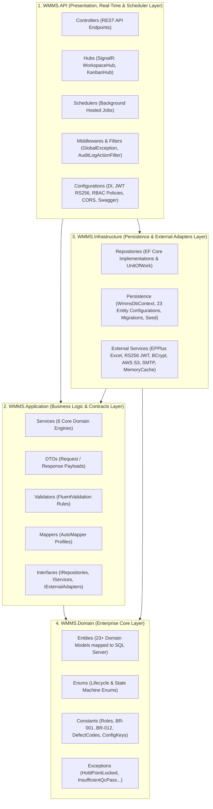

# KIẾN TRÚC PHÂN TẦNG BACKEND — DỰ ÁN WMMS (SEP490_G122)

> **Hệ thống Quản lý Sản xuất Xưởng gỗ (Wooden Manufacturing Management System - WMMS)**  
> **Đơn vị nghiệp vụ:** Công ty TNHH Nguyên Khoa Hà Nam (B2B Wooden Furniture Manufacturing)  
> **Nền tảng Backend:** C# ASP.NET Core Web API (.NET 8) · Entity Framework Core · SQL Server · SignalR · EPPlus

---

## 1. Mục đích Tài liệu

Tài liệu này quy định **kiến trúc phân tầng (Multi-Layer Clean Architecture)**, **cấu trúc Solution/Thư mục**, **ánh xạ 1-1 với tài liệu thiết kế `Report 4 (SDS)` & `Report 3 (SRS)`**, và **quy tắc code bắt buộc** cho toàn bộ thành viên nhóm Backend dự án **WMMS**.

Mọi thành viên khi thêm tính năng, viết API, tạo Entity hay xử lý thuật toán nghiệp vụ **bắt buộc tuân thủ đúng vị trí phân tầng** trong tài liệu này.

---

## 2. Tổng quan Kiến trúc & Chiều Phụ thuộc (4-Project Clean Layered Architecture)

Solution [`WMMS_BE.sln`](./WMMS_BE.sln) được chia thành **4 Project (`.csproj`)** đặt trong thư mục `src/`, kết hợp tổ chức theo **6 Phân hệ Nghiệp vụ cốt lõi** (`Auth`, `Orders`, `BomRouting`, `InventoryPr`, `Warehouse`, `KanbanQc` + `MasterData`):



### Quy tắc Chiều Phụ thuộc (Dependency Rule — BẮT BUỘC)
1. **`WMMS.Domain`**: Tầng trong cùng, **KHÔNG** phụ thuộc vào bất kỳ project nào khác và không cài đặt thư viện hạ tầng (không phụ thuộc EF Core, EPPlus, Web API).
2. **`WMMS.Application`**: Chỉ tham chiếu tới `WMMS.Domain`. Chứa toàn bộ `Interfaces`, `Services` (Business Logic Engines), `DTOs`, `Validators` (FluentValidation), và `Mappers` (AutoMapper). **Tuyệt đối không gọi trực tiếp `WmmsDbContext`** mà phải thông qua `IRepository` và `IUnitOfWork`.
3. **`WMMS.Infrastructure`**: Tham chiếu tới `WMMS.Application` và `WMMS.Domain`. Thực thi `WmmsDbContext` (EF Core SQL Server), các `Repository`, `ExcelPoParser` (EPPlus), `JwtTokenGenerator` (RS256), `S3CloudStorageService`, `SmtpEmailService`, `MemoryCacheService`.
4. **`WMMS.API`**: Tầng giao tiếp ngoài cùng, tham chiếu `WMMS.Application` và `WMMS.Infrastructure` (để đăng ký DI Container). `Controllers` **chỉ gọi `IService`**, nhận/trả `DTO`, tuyệt đối không gọi trực tiếp `IRepository` hay trả trực tiếp `Entity` ra ngoài JSON.

---

## 3. Bảng Ánh xạ 1-1 với 12 Packages trong `Report 4` (`Fig6_Backend_Package.jpg`)

Để đảm bảo code thực tế khớp **100%** với tài liệu **Report 4 – Software Design Specification (Table 1.3 & Figure 1.6)** khi chấm đồ án:

| # | Package trong `Report 4` | Vị trí Project & Thư mục trong `WMMS_BE` | Trách nhiệm chính |
| :-: | :--- | :--- | :--- |
| **01** | `controller` | `src/WMMS.API/Controllers/` | Tiếp nhận HTTP Request, kiểm tra quyền `[Authorize(Roles = ...)]`, gọi Service và trả về `ApiResponse<TDto>`. |
| **02** | `service` | `src/WMMS.Application/Services/` | Chứa 6 Core Domain Engines xử lý toàn bộ nghiệp vụ sản xuất xưởng gỗ. |
| **03** | `repository` | `src/WMMS.Infrastructure/Repositories/` *(Interfaces tại `WMMS.Application/Interfaces/Repositories/`)* | Truy xuất CSDL SQL Server qua EF Core và quản lý Transaction nguyên tử (`IUnitOfWork`). |
| **04** | `entity` | `src/WMMS.Domain/Entities/` | Các lớp thực thể C# ánh xạ với 23 nhóm bảng vật lý trong SQL Server. |
| **05** | `dto` | `src/WMMS.Application/DTOs/` | Data Transfer Objects cho Request / Response giao tiếp với ReactJS SPA. |
| **06** | `mapper` | `src/WMMS.Application/Mappers/` | Cấu hình `AutoMapper` chuyển đổi hai chiều giữa `Entity` và `DTO`. |
| **07** | `validator` | `src/WMMS.Application/Validators/` | Bộ quy tắc `FluentValidation` kiểm tra dữ liệu đầu vào (Staging Grid, Scrap Rate, QC Qty...). |
| **08** | `scheduler` | `src/WMMS.API/Schedulers/` | Background Jobs (`IHostedService`): Gộp PR cuối ngày, quét trễ ETD, mở khóa tài khoản (`JOB-01`), dọn Audit Log (`JOB-02`). |
| **09** | `exception` | `src/WMMS.Domain/Exceptions/` & `src/WMMS.API/Middlewares/` | Các lớp ngoại lệ nghiệp vụ (`HoldPointLockedException`, `InsufficientQcPassException`) & Middleware bắt lỗi toàn cục. |
| **10** | `hubs` | `src/WMMS.API/Hubs/` | SignalR Hubs (`WorkspaceHub`, `KanbanHub`) đẩy sự kiện thời gian thực (< 1s) xuống màn hình xưởng. |
| **11** | `configuration` | `src/WMMS.API/Configurations/` & `src/WMMS.Infrastructure/Persistence/Configurations/` | Cấu hình DI, RS256 JWT, RBAC Policies, CORS, Swagger, và EF Core Fluent API (`IEntityTypeConfiguration<T>`). |
| **12** | `constant` | `src/WMMS.Domain/Constants/` & `src/WMMS.Domain/Enums/` | Hằng số hệ thống: 8 Role codes, Business Rules (`BR-001` $\rightarrow$ `BR-012`), Mã lỗi QC chuẩn hóa, System Config Keys. |

---

## 4. Cấu trúc Thư mục Chi tiết (`src/`)

```text
be/WMMS_BE/
├── WMMS_BE.sln
├── ARCHITECTURE.md
└── src/
    ├── WMMS.Domain/
    │   ├── Common/                      # BaseEntity, IAuditableEntity
    │   ├── Entities/                    # [04. entity] Chia theo 7 nhóm bảng từ Fig7 ERD
    │   │   ├── Identity/                # User, Role, UserRole, RefreshToken, AuditLog
    │   │   ├── Orders/                  # Customer, CustomerOrder (sales_orders), OrderSpace, OrderItem
    │   │   ├── CatalogBom/              # Product, RoutingTemplate, RoutingStage, Material, BomHeader (boms), BomDetail
    │   │   ├── InventoryPr/             # MaterialStock (inventory_stocks), MaterialAllocation, PurchaseRequest (consolidated_prs), PurchaseRequestItem
    │   │   ├── WarehousePo/             # Supplier, PurchaseOrder, PurchaseOrderDetail, GoodsReceipt, InventoryTransaction
    │   │   ├── KanbanQc/                # ProductionBatch, BatchRoutingStep, QcInspection, DefectCatalog, DefectLog, OverdriveLog
    │   │   └── System/                  # SystemConfig (system_configs)
    │   ├── Enums/                       # UserStatusEnum, OrderStatusEnum, SpaceStatusEnum, BomStatusEnum, PrStatusEnum, BatchTypeEnum, DispositionEnum, TxTypeEnum
    │   ├── Constants/                   # [12. constant] RoleConstants, BusinessRuleConstants, DefectCodeConstants, SystemConfigKeys
    │   └── Exceptions/                  # [09. exception] DomainException, HoldPointLockedException, InsufficientQcPassException, ConcurrencyConflictException
    │
    ├── WMMS.Application/
    │   ├── Common/                      # ApiResponse<T>, PagedResult<T>, ValidationResult
    │   ├── Interfaces/
    │   │   ├── Repositories/            # IUnitOfWork, IUserRepository, IOrderSpaceRepository, IBomRepository, IRoutingRepository, IMaterialStockRepository, IMaterialAllocationRepository, IPurchaseRequestRepository, IWarehouseRepository, IProductionBatchRepository, IQcInspectionRepository, ISystemConfigRepository
    │   │   ├── Services/                # IAuthService, IOrderStagingService, IBomRoutingService, IInventoryReconciliationService, IConsolidatedPrService, IAutoAllocationService, IGoodsIssueService, IKanbanExecutionService, IQcBranchingService
    │   │   └── External/                # IExcelPoParser, IExcelBomParser, IJwtTokenGenerator, IPasswordHasher, ICloudStorageService, IEmailService, IWorkspaceNotifier, IKanbanNotifier
    │   ├── Services/                    # [02. service] 6 Phân hệ Nghiệp vụ cốt lõi
    │   │   ├── Auth/                    # AuthService (AUT01, AUT02)
    │   │   ├── Orders/                  # OrderStagingService (ORD01, ORD02)
    │   │   ├── BomRouting/              # BomRoutingService (BOM01, BOM02)
    │   │   ├── InventoryPr/             # InventoryReconciliationService, ConsolidatedPrService (INV01, INV02)
    │   │   ├── Warehouse/               # AutoAllocationService, GoodsIssueService (WHS01, WHS02)
    │   │   ├── KanbanQc/                # KanbanExecutionService, QcBranchingService (KBN01, KBN02)
    │   │   └── MasterData/              # ProductCatalogService, MaterialCatalogService, SupplierService
    │   ├── DTOs/                        # [05. dto] Chia theo module: Auth, Orders, BomRouting, InventoryPr, Warehouse, KanbanQc, MasterData
    │   ├── Validators/                  # [07. validator] FluentValidation cho từng nhóm DTO
    │   └── Mappers/                     # [06. mapper] AutoMapper Profiles
    │
    ├── WMMS.Infrastructure/
    │   ├── Persistence/
    │   │   ├── WmmsDbContext.cs         # DbContext chính của hệ thống
    │   │   ├── Configurations/          # Fluent API IEntityTypeConfiguration<T> cho 23 bảng
    │   │   ├── Migrations/              # EF Core Migrations
    │   │   └── Seed/                    # DbInitializer (Seed 8 Roles, SystemConfigs, DefectCatalog)
    │   ├── Repositories/                # [03. repository] Thực thi các Repository & UnitOfWork
    │   ├── Security/                    # JwtTokenGenerator (RS256), BCryptPasswordHasher (cost=12)
    │   ├── Excel/                       # ExcelPoParser, ExcelBomParser, ExcelReportExporter (EPPlus)
    │   ├── Storage/                     # S3CloudStorageService (AWS S3 CAD/3D/QC Images)
    │   ├── Mail/                        # SmtpEmailService
    │   └── Caching/                     # MemoryCacheService (Catalog 30m, SystemConfigs 60m)
    │
    └── WMMS.API/
        ├── Controllers/                 # [01. controller] AuthController, OrdersController, BomRoutingController, InventoryPrController, WarehouseController, KanbanQcController, MasterDataController, AdminAuditController
        ├── Hubs/                        # [10. hubs] WorkspaceHub, KanbanHub
        ├── Schedulers/                  # [08. scheduler] DailyConsolidatedPrJob, EtdRiskScannerJob, UnlockExpiredAccountsJob, AuditLogCleanupJob
        ├── Middlewares/                 # GlobalExceptionMiddleware
        ├── Filters/                     # AuditLogActionFilter
        ├── Configurations/              # [11. configuration] DependencyInjection, JwtAuthenticationSetup, AuthorizationPolicies, CorsSetup, SwaggerSetup
        ├── Program.cs
        └── appsettings.json
```

---

## 5. Đặc tả 6 Phân hệ & Domain Engines Cốt lõi (Theo `Report 4` Phần II & IV)

### 5.1. Phân hệ 1: Authentication & Multi-Role RBAC (`AUT`)
- **Classes chính (`Fig8`)**: `AuthController` $\rightarrow$ `AuthService` $\rightarrow$ `IUserRepository`, `IJwtTokenGenerator`, `IPasswordHasher` $\rightarrow$ `User`, `Role`, `UserRole`, `RefreshToken`.
- **Quy tắc nghiệp vụ bắt buộc**:
  - **Multi-Role RBAC kiểu Jira**: 1 nhân sự có thể giữ nhiều vai trò đồng thời (`1..*` qua bảng `user_roles`, ví dụ Chủ xưởng kiêm QC). Mảng `roles` trong JWT payload chứa toàn bộ các Role đang active.
  - **8 Vai trò chuẩn**:
    1. `ADMIN` (Quản trị hệ thống, tài khoản, cấu hình tham số, tra cứu Audit Log)
    2. `OWNER` (Chủ xưởng: Giám sát tổng, cấu hình Routing mẫu, duyệt PR gộp ngày, duyệt Overdriver, duyệt lệnh làm bù Scrap)
    3. `SALES` (Nhân viên Kinh doanh: Import Excel PO, CRUD làm sạch trên Staging Grid, đính kèm bản vẽ, Confirm tạo Order Space)
    4. `PLANNER` (Material Planning Staff - KHVT: **Chỉ có quyền Xem (View-only) PO**, tuyệt đối khóa quyền CUD trên PO; chọn Visual Catalog, nạp/custom quy trình sản xuất, lập BOM & tính hao hụt, chạy đối chiếu kho khả dụng, tạo bản gộp PR ngày)
    5. `PURCHASING` (Nhân viên Mua hàng: Nhận PR gộp ngày đã duyệt, phân theo NCC và phát hành PO mua hàng)
    6. `WAREHOUSE` (Thủ kho: Nhập kho GRN & bấm Commit kích hoạt Auto-Allocation; xác nhận Xuất kho cấp phát Goods Issue mở khóa thẻ Kanban; xác nhận Nhập kho thành phẩm)
    7. `LEADER` (Tổ trưởng SX: Kéo thẻ Lô SX trên bảng Kanban, báo cáo tiến độ công đoạn, gửi yêu cầu Overdriver)
    8. `QC` (Nhân viên QC: Nghiệm thu 100% sản phẩm tại cổng mỗi công đoạn; xác nhận Pass hoặc Rework/Scrap kèm mã lỗi bắt buộc)
  - **Bảo mật Token & Lockout**: RS256 Access Token (15 phút) + HttpOnly Secure Refresh Token (7 ngày, xoay vòng mỗi lần refresh). Nhập sai mật khẩu **5 lần liên tiếp** tự động khóa tài khoản **30 phút** (`locked_until`).

### 5.2. Phân hệ 2: Order Intake & Order Space Initialization (`ORD` — `QT-01`)
- **Classes chính (`Fig11`)**: `OrdersController` $\rightarrow$ `OrderStagingService` $\rightarrow$ `ExcelPoParser`, `IOrderSpaceRepository`, `WorkspaceHub` $\rightarrow$ `CustomerOrder` (bảng `sales_orders`), `OrderSpace` (bảng `order_spaces`), `OrderItem` (bảng `order_items`).
- **Quy tắc nghiệp vụ bắt buộc**:
  - **Lọc dữ liệu qua Staging Grid UI**: Khi Sales upload file Excel PO (như `sampleOrder.xlsx` - `PO#22771200`), `ExcelPoParser` loại bỏ thông tin vận tải quốc tế (PI, container, cảng) và chỉ trích xuất: Mã SP (`Item no`), Kích thước (`Size`), Màu/Finish, Chuẩn `FSC 100%`, Quy cách đóng gói (`Inner`/`Master Carton`, `CBM`), Số lượng đặt, Hạn giao `ETD`.
  - **Không lưu DB sớm**: Dữ liệu lỗi định dạng được trả về `StagingGridDto` để bôi đỏ trên UI; chỉ khi Sales sửa hết lỗi và bấm **Confirm**, `ConfirmAndInitOrderSpaceAsync()` mới mở Transaction tạo bản ghi `sales_orders`, `order_items`, khởi tạo `order_spaces` (tương tự Jira Project Space), ghi `audit_logs` và bắn SignalR cho KHVT (`PLANNER`).

### 5.3. Phân hệ 3: BOM Breakdown & Dynamic Routing (`BOM` — `QT-02`)
- **Classes chính (`Fig14`)**: `BomRoutingController` $\rightarrow$ `BomRoutingService` $\rightarrow$ `IBomRepository`, `IRoutingRepository`, `ISystemConfigRepository` $\rightarrow$ `BomHeader` (bảng `boms`), `BomDetail` (bảng `bom_details`), `RoutingTemplate`, `RoutingStage`.
- **Quy tắc nghiệp vụ bắt buộc**:
  - **Kế thừa hoặc tạo mới qua Visual Catalog**: Nếu SKU đã có Active BOM thì tự động nạp lại; nếu chưa có thì chọn từ Visual Catalog theo phân loại sản phẩm (`TABLE`, `CHAIR`, `CABINET`, `BED`, `SHELF`) để nạp chuỗi công đoạn mẫu (`1. Pha phôi` $\rightarrow$ `2. Cắt` $\rightarrow$ `3. Bào/Chà nhám` $\rightarrow$ `4. Mộng` $\rightarrow$ `5. Lắp ráp` $\rightarrow$ `6. Sơn PU` $\rightarrow$ `7. Đóng gói`) và cho phép custom thứ tự công đoạn + đánh dấu trạm chặn kỹ thuật (`IsHoldPoint`).
  - **Công thức tính tổng nhu cầu nguyên vật liệu có hao hụt**:
    $$\text{GrossTotalDemand} = (\text{NetQtyPerUnit} \times \text{OrderedQty}) \times \left(1 + \frac{\text{ScrapRatePercent}}{100}\right)$$
    *(Ngưỡng `ScrapRatePercent` đọc động từ `system_configs`: `DEFAULT_SCRAP_MIN` = 3%, `DEFAULT_SCRAP_MAX` = 5% — có thể cấu hình mở rộng tới 15% tùy loại gỗ).*

### 5.4. Phân hệ 4: Inventory Reconciliation & Consolidated Daily PR (`INV` — `QT-03`)
- **Classes chính (`Fig17`)**: `InventoryPrController` $\rightarrow$ `InventoryReconciliationService`, `ConsolidatedPrService` $\rightarrow$ `IMaterialStockRepository`, `IMaterialAllocationRepository`, `IPurchaseRequestRepository` $\rightarrow$ `MaterialStock` (bảng `inventory_stocks`), `MaterialAllocation` (bảng `material_allocations`), `PurchaseRequest` (bảng `consolidated_prs`), `PurchaseRequestItem` (bảng `consolidated_pr_items`).
- **Quy tắc nghiệp vụ bắt buộc**:
  - **Công thức Tồn kho Khả dụng (Tuyệt đối không đối chiếu vào tồn vật lý thô)**:
    $$\text{AvailableQty}(m) = \max\big(0,\ \text{PhysicalQty}(m) - \text{AllocatedQty}(m)\big)$$
    Trên màn hình đối chiếu của KHVT, hệ thống **chỉ hiển thị `AvailableQty`** (lượng chưa bị đơn khác giữ chỗ).
  - **Khóa giữ chỗ mềm (Soft-Allocation)**:
    - Nếu $\text{AvailableQty}(m) \ge \text{GrossTotalDemand}(m)$: Khóa đủ 100% (`AllocatedQty += GrossTotalDemand`), nếu mọi dòng vật tư trong BOM đều đủ thì chuyển trạng thái BOM sang `READY_FOR_PRODUCTION`.
    - Nếu $\text{AvailableQty}(m) < \text{GrossTotalDemand}(m)$: Khóa phần đang có (`ReservedQty = AvailableQty`), ghi nhận lượng thiếu $\text{ShortageQty} = \text{GrossTotalDemand} - \text{ReservedQty}$, chuyển BOM sang `WAITING_FOR_MATERIALS`.
  - **Tách biệt BOM từng đơn & Gộp tổng mua hàng cuối ngày**: BOM trong từng `OrderSpace` giữ độc lập, nhưng cuối ngày `AggregateDailyShortagesAsync()` gom nhóm (`GROUP BY MaterialId`) toàn bộ lượng thiếu của tất cả các đơn trong ngày thành **1 bản `Consolidated_PR` duy nhất** trình Chủ xưởng duyệt.

### 5.5. Phân hệ 5: Purchasing, Goods Receipt Commit & Auto-Allocation (`WHS` — `QT-04`)
- **Classes chính (`Fig20`)**: `WarehouseController` $\rightarrow$ `AutoAllocationService`, `GoodsIssueService` $\rightarrow$ `IWarehouseRepository`, `IMaterialAllocationRepository`, `WorkspaceHub` $\rightarrow$ `PurchaseOrder`, `GoodsReceipt`, `InventoryTransaction`, `ProductionBatch`.
- **Quy tắc nghiệp vụ bắt buộc**:
  - **Thuật toán Auto-Allocation khi Thủ kho bấm `Commit` Phiếu nhập kho (GRN)**:
    1. Cộng tồn kho vật lý: `PhysicalQty(m) += ReceivedQty(m)`.
    2. Truy vấn tất cả các bản ghi đang chờ nguyên liệu `m` (`WAITING_FOR_MATERIALS`), sắp xếp ưu tiên theo **`CustomerOrder.EtdDate ASC`** (đơn gấp/cận hạn giao hàng nhất được cấp trước) và thời gian tạo đơn.
    3. Tự động phân bổ lượng hàng mới về vào `ReservedQty` và tăng `AllocatedQty(m)`.
    4. Đơn hàng nào được khóa đủ 100% toàn bộ danh mục vật tư trong BOM sẽ tự động chuyển sang `READY_FOR_PRODUCTION` và bắn thông báo SignalR.
  - **Chốt chặn Xuất kho cấp phát (`Goods Issue`)**: Thẻ Lô sản xuất trên bảng Kanban chỉ được mở khóa (`GoodsIssuedUnlocked = true`) khi Thủ kho bấm xác nhận **Xuất kho cấp phát** bàn giao vật tư thực tế xuống xưởng (đồng thời trừ cả `PhysicalQty` và `AllocatedQty`).

### 5.6. Phân hệ 6: Production Kanban, 100% QC Gate & Exception Handling (`KBN` — `QT-05` & `QT-06`)
- **Classes chính (`Fig23`)**: `KanbanQcController` $\rightarrow$ `KanbanExecutionService`, `QcBranchingService` $\rightarrow$ `IProductionBatchRepository`, `IQcInspectionRepository`, `KanbanHub` $\rightarrow$ `ProductionBatch`, `BatchRoutingStep`, `QcInspection`, `DefectCatalog`, `DefectLog`, `OverdriveLog`.
- **Quy tắc nghiệp vụ bắt buộc**:
  - **Quy tắc 100% QC Pass**: Tại công đoạn $S$, Thẻ Lô SX có số lượng đang chạy là $Q$ **chỉ được phép kéo sang cột công đoạn $S+1$** khi QC đã nghiệm thu đủ $100\%$ số lượng ($\text{PassedQty} == Q$). Chặn hoàn toàn thao tác kéo nhảy cóc công đoạn.
  - **Ngoại lệ 1 — Chế độ `Overdriver` & Chốt chặn `Hold Point` (`KBN02`)**:
    - Khi đơn hàng cận ETD đã đủ gỗ thô nhưng thiếu phụ kiện/sơn ở công đoạn sau, Tổ trưởng SX gửi yêu cầu và Chủ xưởng duyệt `Overdriver` (bắt buộc nhập lý do `Justification` và ghi `overdrive_logs` + `audit_logs`).
    - Thẻ được gắn nhãn `[OVERDRIVER]` và cho phép chạy trước các công đoạn đầu ($S < \text{HoldPointStageSeq}$).
    - Ngay khi hoàn thành công đoạn $\text{HoldPointStageSeq} - 1$, nếu phụ kiện vẫn chưa được Thủ kho xác nhận Goods Issue, hệ thống **tự động khóa cứng thẻ** (`BatchStatus = HOLD_POINT_BLOCKED`) ngay trước trạm `HoldPointStageSeq`.
  - **Ngoại lệ 2 — Tách nhánh `97% Oke - 3% Hoàn/Lỗi` (`KBN01` - Kanban Branching)**:
    - Khi QC kiểm định lô $Q = 100$ SP tại công đoạn $S$ và ghi nhận `PassQty = 97`, `FailQty = 3` (bắt buộc chọn mã lỗi chuẩn từ `defect_catalog`: `ERR_CUT_01`/`ERR_WOOD_01`, `ERR_SURF_02`, `ERR_ASSY_03`, `ERR_PAINT_04`):
      - **Thẻ chính (`MAIN_CARD`)**: Tự động cập nhật `BatchQty = 97` và mở khóa chuyển ngay sang cột công đoạn $S+1$ (không bắt 97 SP đạt chuẩn phải chờ).
      - **Nếu lỗi sửa được (`REWORK_SUB_CARD`)**: Tự động sinh **Thẻ nhánh phụ màu cam** (`ParentBatchId = MainBatch.BatchId`, `BatchQty = 3`) để sửa chữa và kiểm định lại.
      - **Nếu hỏng hoàn toàn (`SCRAP_REPLENISH`)**: Ghi nhận phế phẩm và tự động tạo Yêu cầu sản xuất bù (`REPLENISH_LOT`) trình Chủ xưởng phê duyệt xuất thêm phôi gỗ.

---

## 6. Quy chuẩn Kỹ thuật & Đồng bộ Thiết kế Giữa Các Tài liệu

1. **Ánh xạ Tên Class C# và Tên Bảng SQL Server (`Fig7` vs `Fig8`–`Fig23`)**:
   - Tên Class Entity trong C# giữ đúng theo Class Diagram (`CustomerOrder`, `BomHeader`, `MaterialStock`, `PurchaseRequest`, `PurchaseRequestItem`).
   - Trong `WMMS.Infrastructure/Persistence/Configurations/`, sử dụng Fluent API `.ToTable(...)` và `.HasColumnName(...)` để ánh xạ chính xác vào tên bảng vật lý trong ERD `Fig7` (`sales_orders`, `boms`, `inventory_stocks`, `consolidated_prs`, `consolidated_pr_items`...).
2. **Chống xung đột dữ liệu kho (Optimistic Concurrency)**:
   - Bảng `inventory_stocks` (`MaterialStock`) bắt buộc cấu hình cột `[Timestamp] public byte[] RowVersion { get; set; }` (`.IsRowVersion()`) để đảm bảo khi Thủ kho bấm `Commit` nhập kho và KHVT chạy đối chiếu cùng lúc sẽ không bao giờ xảy ra lỗi âm kho hoặc mất cập nhật.
3. **Chiến lược Caching & Real-time**:
   - Sử dụng `IMemoryCache` cho Visual Product Catalog (`cache:catalog:{sku}`, TTL 30 phút) và System Configs (`cache:sys:configs`, TTL 60 phút); xóa cache ngay khi có thay đổi.
   - Mọi thay đổi trạng thái trên Bảng Kanban và Order Space phải được đẩy qua `KanbanHub` và `WorkspaceHub` (SignalR).
4. **Audit Trail Tự động**:
   - Mọi thao tác làm thay đổi trạng thái quan trọng (`CREATE_SPACE`, `OVERDRIVE_APPROVE`, `COMMIT_GRN`, `QC_BRANCH`, `APPROVE_PR`) phải đi qua `AuditLogActionFilter` hoặc `IAuditLogService` để lưu snapshot JSON `before_state` và `after_state` vào bảng `audit_logs`.
